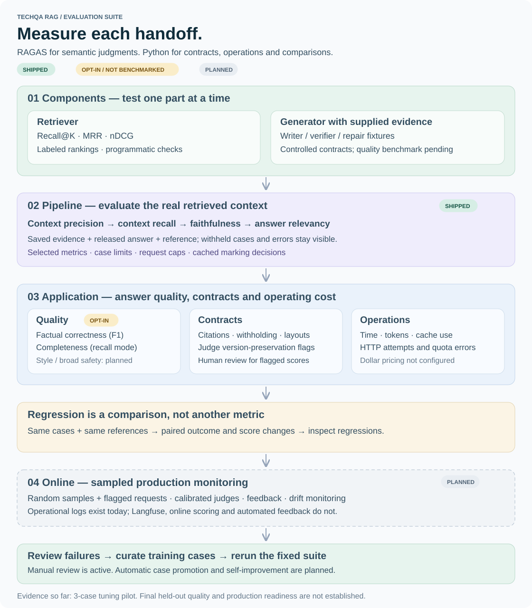

# TechQA RAG

A technical-support RAG workspace built around IBM TechQA. It retrieves source passages, writes a cited answer, and checks the answer before showing it. If the evidence is insufficient, it withholds the solution.

The repository contains application code, preparation/evaluation tools and offline tests. Datasets, model weights, vectors, credentials, raw evaluation outputs and working notes are kept outside Git. A redacted evaluation summary and synthetic examples are published below.

## How it works

```text
Question → Gemma embedding → Qdrant exact search → BGE reranking
         → evidence selection → Groq answer → separate verification
         → cited answer + checked OpenUI components
```

- **Retrieval:** pinned `google/embeddinggemma-2`, cosine search over structured HTML chunks, BGE reranking and reciprocal-rank fusion with the dense ranking.
- **Evidence:** a bounded context pack retains source identities and coordinates. The serving retriever currently uses dense search; BM25/hybrid helpers are available for evaluation, not enabled in the live path.
- **Answers:** Groq `openai/gpt-oss-120b` writes and separately verifies an answer. One repair is allowed; unresolved evidence gaps withhold the answer.
- **UI:** Next.js/React and OpenUI render finding cards, steps, configuration rows and citations. All generated factual fields, including hidden tabs, are checked before release. Invalid layouts fall back to verified text.
- **Sessions:** recent conversation plus a summary, current-session memory, exact answer caching and an explicit regeneration bypass.
- **Evaluation:** an offline RAGAS runner scores saved evidence and released answers. Judge decisions and local query embeddings are cached; withheld responses and evaluation errors stay visible.

## Inspect a run in LangSmith

Add `LANGSMITH_API_KEY` to the server's `.env`. The default project is `techqa-rag`. Set `LANGSMITH_TRACING=false` to disable export. Traces contain questions, retrieved passages, private drafts and verification decisions, so keep this project private.

Each question has a parent trace with child steps for query embedding, exact search, reranking, context selection and model calls. Inspect timings, actual token usage, cache hits, source passages, repair attempts and the released outcome. The answer workspace links to its trace. Local diagnostic logs continue to work when tracing is disabled or export fails.

The workspace streams actual activity and retrieved excerpts. Verified answers and checked OpenUI layouts appear after their release checks. The run history remains available after completion. Desktop uses a compact navigation rail, while smaller screens stack the answer and evidence.

For developers and coding agents, `/ask` remains a server-sent event endpoint. `stage` events describe activity, `evidence` carries retrieved `sources`, `final` carries the approved outcome and `error` carries a safe error category/message. `done` closes the run. Final statuses are `answered`, `needs_clarification` and `insufficient_evidence`. Existing exact-cache, session, cancellation and regeneration behavior remains covered by tests.

Collect a fixed random training sample with a hard HTTP-attempt cap. Quota failures stop collection and are retried when the same unchanged run resumes. Completed cases are saved after each question, with a `completed.json` snapshot for inspection.

```bash
python -m scripts.eval_ragas collect --limit 12 --sample-seed 20261110 \
  --max-requests 18 --output data/ragas/review
python -m scripts.publish_langsmith --cases data/ragas/review/completed.json
```

Publishing replays saved outputs into a LangSmith experiment with response status, selected-reference-article presence and citation-format checks. It makes **zero new model calls**. Add `--ragas path/to/matching-report.json` to publish existing semantic scores too. RAGAS judging remains a separate, explicitly budgeted command below. Reviewed or failed judge results retain their flags.

The [November 10 observability batch](evaluations/results/observability_v1.json) selected **12 training questions**. Retrieval selected the labeled article for **11/12**. **3 answers** were released and passed citation-format checks. **9 provider quota failures** prevented completion. The run used **15 HTTP attempts and 33,230 reported tokens**. This batch establishes dashboard visibility and exposes a quota-handling issue, which is now covered by a stop-on-quota regression test. New semantic RAGAS scores await available provider quota.

## Evaluation suite



**Evaluate the parts, then their handoff, then the delivered answer.** RAGAS supplies semantic metrics; our Python checks cover source/citation contracts, recorded usage, judge integrity and paired regressions. Unit tests exercise failure handling with controlled fixtures. No single score is called “RAG accuracy.”

| Layer | What we check | Implementation and status |
|---|---|---|
| Components | Retrieval Recall@K, MRR and nDCG against known article labels; writer/verifier behavior with supplied evidence | [Rank metrics](scripts/baseline.py), [retrieval tests](tests/test_app_retriever.py), [generator contract fixtures](tests/test_app_generation.py). Controlled fixtures are not a generator quality benchmark. |
| Pipeline | Selected context precision/recall, answer faithfulness and relevancy | [RAGAS runner](scripts/eval_ragas.py), measured on the pilot below. Reference text stays outside inference. |
| Application | Reference-based correctness and completeness; citation validity; withholding and layout contracts; recorded timing/tokens/cache use | Correctness = RAGAS `FactualCorrectness(mode="f1")`; completeness = its `mode="recall"` proxy. Both are opt-in and not yet benchmarked. [Free saved-case checks](scripts/eval_suite.py), [API contracts](tests/test_app_api.py), [layout checks](frontend/tests/genui-contract.test.mjs) are implemented. |
| Regression | Re-run a fixed case set, then inspect per-case differences | [Comparison CLI](scripts/eval_suite.py) rejects changed cohorts/references. Semantic comparisons also require matching judge settings and exclude scores flagged for review. |
| Online | Sampled live judging, feedback, drift and failure-to-test-set promotion | **Planned.** Content-free operational logs exist; live quality scoring, Langfuse integration and automated feedback loops do not. |

Style rubrics and broad toxicity/PII/jailbreak evaluation are also planned. Existing origin/session, withholding and generated-component checks cover specific application contracts; they are not a comprehensive safety benchmark. Optional semantic metrics compare against available references, which may omit valid alternative answers.

### Component measurements already recorded

A separate [offline retrieval replay](evaluations/results/retrieval_baseline_v1.json) used **97 known-positive training tuning questions**. Article Recall@5 was **83/97 (85.57%)** and Recall@10 **87/97 (89.69%)**. The packed-context reference-word-run proxy passed **80/97 (82.47%)**; that proxy is not semantic context recall.

A 120-query local Qdrant search check recorded **24.41 ms p50 / 38.54 ms p95**, using saved query vectors. Those timings exclude query encoding, reranking and generation. These historical component runs have different conditions and denominators from the three-case pipeline pilot below.

### Measured pilot, with its limitations

The pilot used the **first three sorted answerable IDs** in the saved training tuning split. It produced **one answer and two withheld responses**. Final development was not evaluated.

| Case | Outcome | Context precision | Context recall | Faithfulness | Answer relevancy |
|---|---|---:|---:|---:|---:|
| TRAIN_Q007 | Withheld | 0.756 | 0.000 | Skipped | Skipped |
| TRAIN_Q008 | Withheld | 0.887 | 1.000 | Skipped | Skipped |
| TRAIN_Q013 | Answered | 0.792 | 1.000 | **0.500 — judge error flagged** | 0.979 |
| Raw mean | 1 answered / 3 attempted | **0.812 (n=3)** | **0.667 (n=3)** | **0.500 (n=1)** | **0.979 (n=1)** |

Eight metric results succeeded, four were deliberately skipped, and the completed pass had zero metric errors. These are integration observations, not final accuracy or a measured improvement.

The failure review matters as much as the averages:

- **Q007:** the selected evidence missed the reference information. Related MQ passages could score as useful while context recall remained zero.
- **Q008:** the selected evidence supported the reference, but the pipeline withheld. Inspect the release path, rather than assume retrieval failed.
- **Q013:** the judge changed **“TIP 2.1” to “TIP 1”** while extracting claims, then penalized its altered claim. The raw faithfulness score is retained and flagged; it is not reliable evidence of an unsupported application answer. The new version-preservation heuristic catches this for review without rewriting the score.

The [published, redacted result](evaluations/results/techqa_pilot_v1.json) includes per-case outcomes, denominators, settings, source-artifact hashes and review flags. Questions, references, source passages, credentials and full judge traces remain local. The summary records the November 3 run; today's export and additional contract checks made **zero new live judge calls**.

| Recorded operation | Observation | Scope |
|---|---:|---|
| Answer coverage | 1/3 | Reported separately from conditional answer scores |
| Selected gold-article hit | 2/3 | Final evidence only; **not search Recall@10** or semantic recall |
| Citation contract | 1/1 released answer | IDs/format only; does not prove factual support |
| Completed resumed scoring pass | 48.90 s; 17,135 reported tokens | 25 cached judgments, 8 fresh judgments; earlier passes cost extra |
| Historical cache replay | 33 hits, 0 misses, **0 API calls** | Same raw scores; 0.022 s scoring loop excludes startup/imports |
| Correctness / completeness | Not measured | Available as opt-in RAGAS checks |
| Dollar cost / online drift | Not measured | Pricing and online monitoring not configured |

### Try the suite without a model or dataset

After installing `requirements-test.txt`, run the [synthetic demonstration](evaluations/fixtures/offline_demo.json):

```bash
python -m scripts.eval_suite report \
  --cases evaluations/fixtures/offline_demo.json --output /tmp/eval-demo.json
python -m scripts.eval_suite compare \
  --baseline /tmp/eval-demo.json --candidate /tmp/eval-demo.json \
  --output /tmp/eval-diff.json
```

The report checks selected-document hits, citation contracts and outcomes. It does not run an LLM. The comparison prints paired changes; an unchanged demo should have no regressions. CI exercises this path, the budget controls and actual RAGAS aggregation with mocked judge decisions. Synthetic test results are kept separate from the TechQA pilot.

## Requirements

Python 3.13, Node.js 22, npm, uv, Docker Compose, a Groq API key, and prepared TechQA/model artifacts. The frontend and API run locally; Qdrant runs in Docker.

### Run the offline checks first

No datasets, model downloads, API keys or Qdrant server are needed for these checks:

```bash
uv venv --python 3.13 .venv-test
uv pip install --python .venv-test/bin/python -r requirements-test.txt
.venv-test/bin/python -m pytest -q

cd frontend
npm ci
npm run test:genui
npm run typecheck
npm run lint
npm run build
```

GitHub Actions runs the same checks. The tests use synthetic data and controlled model outputs; they are not a live answer-quality benchmark.

### Configure the application

```bash
uv venv --python 3.13 .venv-ingest
uv pip install --python .venv-ingest/bin/python -r requirements-app.txt
cp .env.example .env
```

Set `GROQ_API_KEY` in the root `.env`. Existing installations can use the `GROK_API_KEY` alias. Keep the key server-side; do not use a `NEXT_PUBLIC_` variable.

The model namespace starts with `openai/`, but requests go to **Groq's API**. The model is configured centrally in `rag_app/generation.py`.

Generation uses remaining-token/reset headers to pace calls and keeps quota waits within request deadlines. The token estimate is approximate and applies to one provider instance, not a shared multi-worker quota. Offline case collection saves private writer/repair/verifier results and content-free HTTP statuses for diagnosis; these artifacts stay outside Git and are never returned as released answers.

### Prepare or restore artifacts

This is a code-only checkout, not a bundled dataset or one-command model download. Restore the matching prepared artifacts before serving:

| Location | Purpose |
|---|---|
| `data/runs/html_v1/documents.json` | Prepared document text and metadata |
| `data/runs/html_v1/structured_512/chunks.jsonl` | Ordered document chunks |
| `data/retrieval_runs/gemma2_structured_512_html_v1/config.json` | Source hashes, vector-cache identity and query membership |
| `data/embedding_cache/<cache_key>/state.json` and `vectors.npy` | Complete, verified document/query vector cache |
| `data/tokenizers/bge_wordpiece/` | Pinned reference tokenizer and its `source.json` hash record |
| `data/models/hub/models--google--embeddinggemma-2/snapshots/<revision>/` | Local Gemma snapshot matching `models-embeddings.json` |
| `data/models/hub/models--BAAI--bge-reranker-base/snapshots/2cfc18c9415c912f9d8155881c133215df768a70/` | Local BGE reranker snapshot |

`RAG_RERANKER_DIR` can override the reranker location with an absolute path or a path relative to the project root. Serving validates local assets and does not silently download missing weights.

The current importer deliberately targets the audited snapshot: **28,482 articles, 99,697 document chunks and 120 trailing query vectors**. Query vectors are excluded from the Qdrant collection. Use the versioned update workflow below for subsequent document changes. Changes to the embedding or chunking policy require a separately prepared index.

Preparation code is included in `scripts/audit_techqa.py`, `baseline.py`, `chunking.py`, `ingest_html.py` and `eval_embeddings.py`. Rebuilding requires the original release, tokenizer manifests and the pinned model access; embedding preparation uses a CUDA runtime. It is separate from the local serving setup.

Obtain TechQA from the [PrimeQA release](https://huggingface.co/datasets/PrimeQA/TechQA), pinned revision `60437bc79ab217679682217598a3693cab78365b`. Check the release's bundled data terms; the local audit identified CDLA Permissive 1.0 despite different hosting metadata. Dataset/model licenses are separate from this code repository. No dataset text or model weights are redistributed here.

### Import the existing vectors

```bash
docker compose up -d
.venv-ingest/bin/python -m scripts.import_qdrant --dry-run
.venv-ingest/bin/python -m scripts.import_qdrant
```

On a Mac using Colima, start Colima first. If Compose is installed as a standalone executable, use `docker-compose` instead of `docker compose`.

The importer verifies manifests, dimensions, finite/unit vectors and row identities before writing. It builds `data/source.sqlite3` and the `techqa_html_v1_gemma2` collection. Keep source/index backups together. Do not use `docker compose down -v` unless you intend to delete the database volume.

### Start the API and UI

In one terminal:

```bash
.venv-ingest/bin/python -m uvicorn rag_app.api:app --host 127.0.0.1 --port 8000
```

In another:

```bash
cd frontend
npm ci
npm run dev -- --hostname 127.0.0.1
```

Open `http://127.0.0.1:3000`. The example `APP_ORIGIN` matches that address. For another origin, update it explicitly. The frontend proxies to `http://127.0.0.1:8000`; set the full `/ask` URL in `RAG_API_URL` inside `frontend/.env.local` to change the upstream.

`GET /health/live` checks the API process. `GET /health/ready` checks the key, pinned model assets, source hash and active index identity/count. The first request loads local models, so cold-start latency differs from subsequent requests.

## V1 acceptance and operation

The local V1 uses one API worker and Docker Qdrant. Its [redacted acceptance results](evaluations/results/v1_acceptance.json) record the checks and their scope.

| Check | Observation |
|---|---|
| Saved training-context replay | **80/97 → 83/97**, three gains and zero losses, using a reference-word coverage proxy |
| Changed-document drill | **2 chunks embedded, 99,695 vectors reused** across add/update/delete, followed by a zero-embedding repeat and successful rollback |
| Backup recovery | **28,482 documents / 99,697 vectors** validated, with identical exact-search top-ten results for three saved query vectors |
| Verifier calibration | **4/4** targeted canaries passed |
| Four final targeted questions | One answered, one clarification, two withheld |
| Live acceptance usage | **15/15 HTTP 200**, **62,248 reported tokens** across initial checks, canaries and the final generation pass |

The replay uses training tuning questions and a text-coverage proxy. Final generation reused the newly selected contexts. These measurements support the targeted fixes. Full held-out answer quality remains a later milestone. Q046/Q037 still withhold, and historical RAGAS review flags remain visible.

Browser acceptance uses the existing controlled GenUI fixture. It checks rendering, excerpts, structured Run details, regeneration and session clearing. The API suite also covers the storage/search/verification handoff, session isolation, exact cache invalidation after an index change and bounded concurrent admission.

### Update documents and roll back

After the initial import, register the existing index once. Adoption validates source membership, payload versions, vector dimensions and norms.

```bash
.venv-ingest/bin/python -m scripts.manage_index adopt
.venv-ingest/bin/python -m scripts.manage_index status
```

An update file maps document IDs to records with `title`, `text` and `metadata`. Optional `content` supplies original HTML for the existing Docling parser. Keep the original body in `text` when providing HTML so exact source matches can be mapped. Changed documents retain their raw input in the source store.

```json
{
  "your-document-id": {
    "title": "Updated support article",
    "text": "The updated article body.",
    "metadata": {"productName": "Your product"}
  }
}
```

Stage changes into a separate collection, then activate the returned build ID. An unchanged input reuses its existing version. Deletion can be run with `--delete` alone. Policy fingerprints prevent mixing a changed model/parser/chunker configuration with old vectors.

```bash
.venv-ingest/bin/python -m scripts.manage_index stage --updates /path/to/updates.json
.venv-ingest/bin/python -m scripts.manage_index stage --delete document-id-to-remove
.venv-ingest/bin/python -m scripts.manage_index activate BUILD_ID
.venv-ingest/bin/python -m scripts.manage_index validate
.venv-ingest/bin/python -m scripts.manage_index activate PREVIOUS_BUILD_ID
```

Staging copies unchanged vectors to preserve an isolated, recoverable version. It embeds the changed documents only. The serving process picks up activation on its next request. Keep version directories and their Qdrant collections together. Stage each batch from the currently active version. If the activation pointer is lost, serving stops until you explicitly activate a validated build.

### Back up and restore

```bash
.venv-ingest/bin/python -m scripts.manage_index backup /path/to/new-backup-directory
.venv-ingest/bin/python -m scripts.manage_index restore /path/to/backup-directory
.venv-ingest/bin/python -m scripts.manage_index activate RESTORE_ID
```

The backup contains a native Qdrant snapshot, matching SQLite sources and checksums. Restore creates a separate collection and returns `restore_id`. Activation validates the pair before changing the local pointer. This workflow is tested on a single-node Docker Qdrant. See the [Qdrant snapshot documentation](https://qdrant.tech/documentation/snapshots/) for the underlying snapshot operations.

### Inspect runs and operating bounds

The local service admits five requests, processes one at a time, waits up to 30 seconds for the worker and bounds each request at 180 seconds. Provider quota waiting contributes to response time. Controlled concurrency tests exercise these bounds. Public traffic capacity needs a separate load measurement.

Run details displays stage times, model/index/prompt identities, cache hits, token usage and HTTP attempts. Local metrics are content-free, capped at 100 MiB and seven days. Retrieval caches retain up to 2,048 query vectors and 50,000 pair scores. Existing answer-cache/session limits apply as well.

Set `RAG_TRACE_DIR` in the backend environment to opt into private local JSON traces containing the question, candidates, selected passages and generation decisions. Traces use owner-only file permissions and retain up to 50 files, 128 MiB and seven days. Keep that directory outside public hosting and Git. Gold references remain in offline evaluation artifacts.

## Run RAGAS offline

```bash
uv venv --python 3.13 .venv-ragas
uv pip install --python .venv-ragas/bin/python -r requirements-ragas.txt
.venv-ingest/bin/python -m scripts.eval_ragas collect --limit 3
.venv-ragas/bin/python -m scripts.eval_ragas run \
  --metrics context_precision context_recall --limit 3 --max-requests 12
```

Collection additionally requires `data/splits/techqa_v1.json` and the original training question/document files under `data/raw/techqa/TechQA/training_and_dev/`. References are checked against original answer spans and never passed to inference.

Collection saves standalone canonical answers, without session memory or UI generation. Scoring runs only the explicitly selected metrics, sequentially. Only answer relevancy loads local Gemma; the other judge metrics do not require local embedding weights. Results, per-call marking decisions, usage and caches stay under `data/ragas/`. Use a new output directory for a changed case set or serving-code version; see `--help` for paths and judge/timeout options.

Choose metrics for the change you are investigating:

- Retrieval/context change: `--metrics context_precision context_recall`.
- Answer-writing change: `--metrics faithfulness answer_relevancy`.
- Reference-based application review: `--metrics factual_correctness answer_completeness` (opt-in; no pilot scores yet).

The default scoring limit is three cases and **12 HTTP attempts, including retries**. Set `--max-requests 0` for cache-only execution; missing decisions become `budget_exhausted`, not zero quality. Use a fresh `--output` for a comparison; omitted output names are timestamped so earlier reports survive. These are request caps, **not a dollar/token spending guarantee**. Inspect actual usage before raising them; one metric can make several calls.

Create a free report from actual local artifacts:

```bash
python -m scripts.eval_suite report --cases data/ragas/pilot_v1 \
  --ragas data/ragas/results/pilot_v1.json --output /tmp/pilot-review.json
```

Compare two reports with the `compare` command above. Cohort and reference identities must match. Judge/embedding settings must also match before semantic score deltas are reported; flagged scores stay visible but are excluded from those deltas. A negative delta is an observed regression to inspect, not statistical proof.

Failed evaluations are not zero scores; answer metrics are skipped on withheld cases. LLM judges can alter facts during claim extraction, so inspect their decisions before using scores as quality gates.

## Operating limits

- Intended for controlled local/demo use. Authentication and a public multi-user deployment are not implemented.
- Sessions and answer caches are process-local. Persistent query/pair caches need an eviction policy before sustained public traffic.
- Requests have queue, rate and deadline controls. Groq quota waits can dominate latency.
- Verified components appear progressively after checking; unverified draft tokens are not streamed to users.
- Backup restoration, broader answer-quality evaluation and production load testing remain separate work.

The initial history is a reconstructed import of local build stages from October 28–November 3, 2026. Author and committer dates identify those reconstructed stages; the repository was first published on November 3, 2026. It is not an archive of the exact working tree at each historical moment. Subsequent commits record ongoing development normally.
